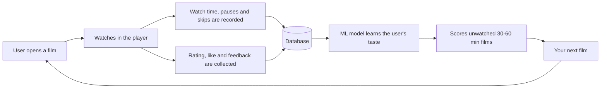
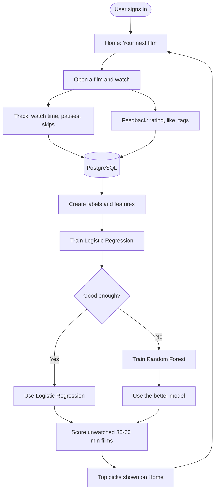

# NextWatch

**A recommender for 30 to 60 minute films that learns from how you actually watch.**

## What is NextWatch?
NextWatch is a film platform where every title runs **30 to 60 minutes**. Instead of "search a movie, get similar movies", it watches *how* you watch: how much you finish, what you rate, what you like and what you tell it afterwards. A machine learning model uses those signals to pick your next film.

## How it works

1. **Watch:** the user opens a film and watches it in an embedded player.
2. **Track:** the app records watch time, pauses, skips and where the viewer dropped off.
3. **Feedback:** after the film the user gives a rating (1-10), a like or dislike, and quick tags.
4. **Learn:** these signals become labels (liked or not liked) and features (user history, genre affinity, film popularity, runtime). A Logistic Regression model is trained first, and a Random Forest is tried if it is not good enough.
5. **Recommend:** the best model scores every unwatched film, and the top picks appear on Home. New users see popular films until they have some history.

## NextWatch flowchart

## Technologies used
| Area | Technology |
|---|---|
| Frontend | React 19, Vite, Tailwind CSS, React Router |
| Backend | FastAPI, SQLAlchemy, JWT authentication, Google Sign-In |
| Database | PostgreSQL |
| Machine learning | Python, scikit-learn (Logistic Regression, Random Forest), pandas, NumPy |
| Video and catalog | YouTube embedded player and YouTube Data API (CC BY films only) |
| Tools | Git and GitHub, VS Code, pgAdmin |

## Applications
- **Short-film and documentary streaming:** a personal "what should I watch tonight" for content that fits an evening, a lunch break or a commute.
- **Micro-learning platforms:** recommending the next 30 to 60 minute lecture or documentary from how learners actually watch.
- **OTT and creator platforms:** a ready pattern for using watch time and feedback, instead of only clicks, to drive recommendations.
- **Recommender-system learning and research:** a complete example of implicit feedback, leakage-free features and model comparison against a popularity baseline.

## Author
**Vishal Fulbandhe**
B.Tech CSE (AI and ML) student

[LinkedIn](https://www.linkedin.com/in/vishal-fulbandhe-16662832b/) · [GitHub](https://github.com/codervishal207max)
